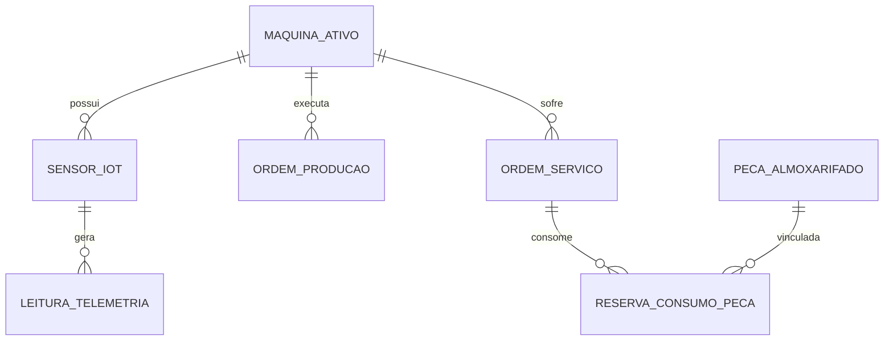

### 1. Estilo Arquitetural
A arquitetura adotada é **Hexagonal (Ports and Adapters)**, essencial para isolar o núcleo de negócio (Domain) das tecnologias de persistência e interfaces externas. Esta escolha garante que as regras de OEE, MTBF e gestão de estoque permaneçam agnósticas a mudanças em bancos de dados (PostgreSQL/TimescaleDB) ou protocolos de comunicação (MQTT/REST), facilitando a testabilidade e a evolução do sistema conforme a norma ODS 9.

### 2. Tabela de Padrões
| Categoria | Padrão | Aplicação no ForgeTwin |
| :--- | :--- | :--- |
| **Criação** | Factory Method | Instanciação de conectores de telemetria e processadores de notificação. |
| **Estrutural** | Adapter | Normalização de payloads de diferentes Gateways IoT para o formato interno. |
| **Comportamental** | Strategy | Algoritmos intercambiáveis para cálculo de OEE e priorização de SLA. |
| **GRASP** | Repository | Abstração da persistência para isolar o domínio de consultas SQL. |
| **GRASP** | Information Expert | Atribuição de responsabilidade de cálculo de OEE à entidade `OrdemProducao`. |

### 3. Bloco SQL (DDL)
```sql
CREATE TABLE maquina_ativo (
    id SERIAL PRIMARY KEY,
    codigo_tag VARCHAR(50) UNIQUE NOT NULL,
    criticidade CHAR(1) CHECK (criticidade IN ('A', 'B', 'C')),
    status_operacional VARCHAR(20)
);

CREATE TABLE leitura_telemetria (
    id BIGSERIAL PRIMARY KEY,
    sensor_id INT NOT NULL,
    valor_medido NUMERIC(12,4),
    timestamp_leitura TIMESTAMP WITH TIME ZONE DEFAULT CURRENT_TIMESTAMP,
    CONSTRAINT fk_sensor FOREIGN KEY (sensor_id) REFERENCES sensor_iot(id)
);

CREATE TABLE ordem_servico (
    id SERIAL PRIMARY KEY,
    numero_os VARCHAR(20) UNIQUE NOT NULL,
    maquina_id INT NOT NULL,
    status_os VARCHAR(20),
    CONSTRAINT fk_maquina FOREIGN KEY (maquina_id) REFERENCES maquina_ativo(id)
);
```

### 4. Bloco Mermaid (ERD)


### 5. Trade-offs
*   **Complexidade Inicial:** A arquitetura hexagonal exige maior esforço de implementação inicial devido à criação de interfaces e adaptadores.
*   **Performance vs. Isolamento:** O uso de *Repository* adiciona uma camada de abstração que pode introduzir latência mínima, mitigada pelo uso de *caching* (Redis).
*   **Consistência:** A separação entre dados transacionais (PostgreSQL) e séries temporais (TimescaleDB) aumenta a complexidade da infraestrutura, mas é vital para a escalabilidade da telemetria.
*   **Manutenibilidade:** O desacoplamento permite substituir o broker de mensagens ou o banco de dados sem impactar as regras de negócio de OEE e manutenção.