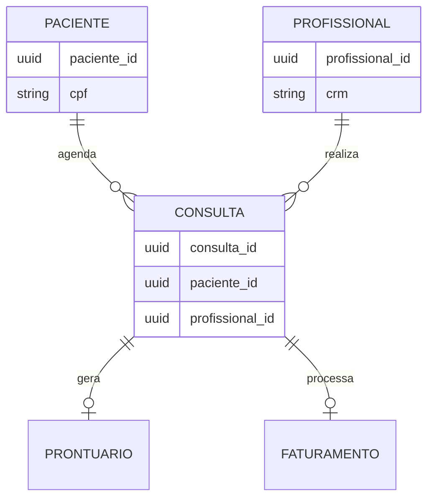

### ADR: Arquitetura de Microsserviços para HealthSync

**1. Estilo Arquitetural**
A arquitetura baseia-se em **Microsserviços orientados a eventos**, utilizando um *API Gateway* para orquestração de entrada e *Event Bus* (Kafka) para comunicação assíncrona entre domínios (ex: agendamento disparando notificação). Esta escolha garante o desacoplamento necessário para a escalabilidade horizontal exigida (50k usuários), isolamento de falhas e conformidade com a modularidade solicitada, permitindo que módulos como Faturamento e Telemedicina evoluam independentemente.

**2. Tabela de Padrões**

| Categoria | Padrão | Aplicação no HealthSync |
| :--- | :--- | :--- |
| **Criação** | Factory Method | Criação de diferentes tipos de prontuários/laudos conforme especialidade. |
| **Estrutural** | Adapter | Integração com sistemas legados e padrões HL7/FHIR/TISS. |
| **Comportamental** | Observer | Notificação de pacientes e médicos sobre eventos de agenda/exames. |
| **GRASP** | Information Expert | Atribuição da lógica de cálculo de faturamento à classe `Fatura`. |
| **GRASP** | Repository | Abstração do acesso a dados clínicos (PEP) e cadastrais. |

**3. Modelo de Dados (SQL)**

```sql
CREATE TABLE pacientes (
    paciente_id UUID PRIMARY KEY,
    cpf VARCHAR(11) UNIQUE NOT NULL,
    cns VARCHAR(15) UNIQUE,
    nome VARCHAR(255) NOT NULL
);

CREATE TABLE profissionais (
    profissional_id UUID PRIMARY KEY,
    crm VARCHAR(20) UNIQUE NOT NULL,
    especialidade VARCHAR(100)
);

CREATE TABLE consultas (
    consulta_id UUID PRIMARY KEY,
    paciente_id UUID REFERENCES pacientes(paciente_id),
    profissional_id UUID REFERENCES profissionais(profissional_id),
    data_hora TIMESTAMP NOT NULL,
    status VARCHAR(20)
);
```

**4. Diagrama ER (Compacto)**



**5. Trade-offs**
*   **Complexidade Operacional:** A arquitetura de microsserviços exige maturidade em DevOps e observabilidade (monitoramento distribuído).
*   **Consistência de Dados:** O uso de bancos distribuídos (PostgreSQL/MongoDB) impõe o desafio da consistência eventual, mitigada por transações distribuídas ou *Saga Pattern*.
*   **Latência de Rede:** A comunicação entre serviços via rede introduz latência, compensada pelo uso de *caching* (Redis) e mensageria assíncrona.
*   **Segurança:** A descentralização aumenta a superfície de ataque, exigindo *Zero Trust* e gestão rigorosa de identidades (OAuth2/MFA).