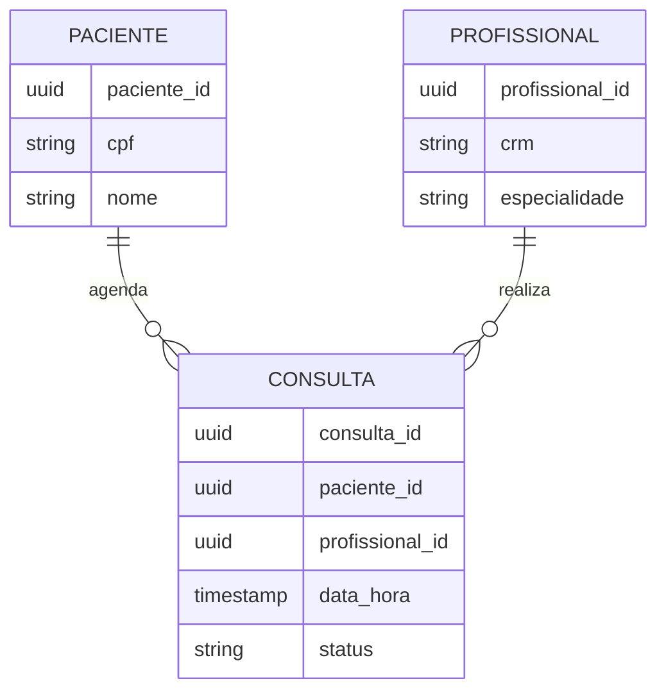

### 1. Isolamento via Repository e Information Expert
O **Repository** isola a persistência, abstraindo a lógica de acesso a dados e permitindo a troca de tecnologias sem afetar o domínio. O **Information Expert** atribui responsabilidades de manipulação de dados à classe que detém a informação necessária, garantindo encapsulamento e coesão. Juntos, desacoplam a regra de negócio da infraestrutura, facilitando a manutenibilidade e testes unitários.

### 2. DDL (SQL)
```sql
CREATE TABLE pacientes (
    paciente_id UUID PRIMARY KEY,
    cpf VARCHAR(11) UNIQUE NOT NULL,
    nome VARCHAR(255) NOT NULL,
    data_nascimento DATE NOT NULL
);

CREATE TABLE profissionais (
    profissional_id UUID PRIMARY KEY,
    crm VARCHAR(20) UNIQUE NOT NULL,
    nome VARCHAR(255) NOT NULL,
    especialidade VARCHAR(100)
);

CREATE TABLE consultas (
    consulta_id UUID PRIMARY KEY,
    paciente_id UUID REFERENCES pacientes(paciente_id),
    profissional_id UUID REFERENCES profissionais(profissional_id),
    data_hora TIMESTAMP NOT NULL,
    status VARCHAR(50) DEFAULT 'AGENDADA'
);
```

### 3. Diagrama (Mermaid)
