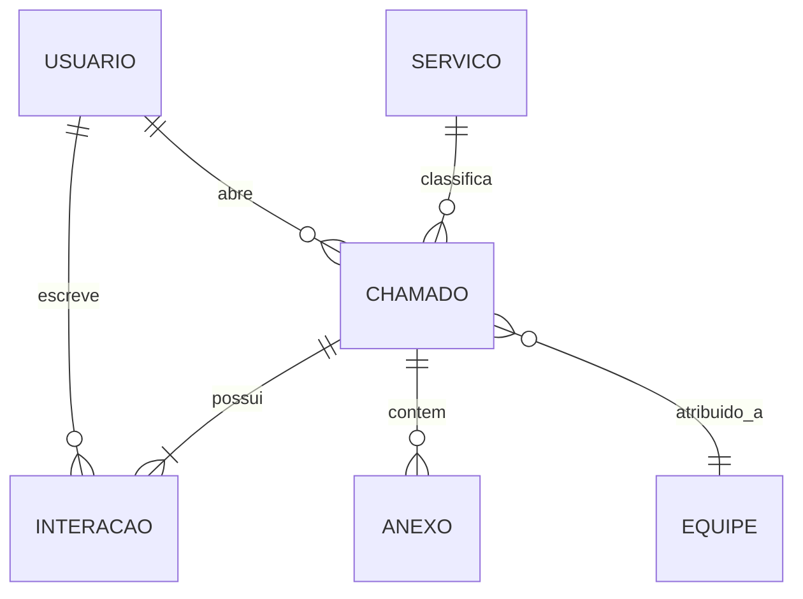

### 1. Estilo Arquitetural
**Arquitetura em Camadas (Layered Architecture) com API-First:** A escolha justifica-se pela necessidade de separação clara entre a lógica de negócio (Domain Layer), a persistência (Data Access Layer) e a interface (Presentation Layer). Este estilo facilita a manutenibilidade, a testabilidade unitária e a escalabilidade horizontal dos serviços, permitindo que a API atenda tanto ao portal web quanto a integrações externas de forma desacoplada e segura.

### 2. Tabela de Padrões

| Categoria | Padrão | Aplicação no HelpFlow |
| :--- | :--- | :--- |
| **Criação** | Factory Method | Criação de diferentes tipos de notificações (e-mail, push, sistema). |
| **Estrutural** | Facade | Interface simplificada para o subsistema de SLA e Auditoria. |
| **Comportamental** | Observer | Notificação de agentes e solicitantes sobre mudanças de status. |
| **GRASP** | Repository | Abstração do acesso a dados de Chamados e Usuários. |
| **GRASP** | Information Expert | Atribuição da responsabilidade de cálculo de SLA à classe `SLAEngine`. |

### 3. DDL (SQL)
```sql
CREATE TABLE usuarios (
    id UUID PRIMARY KEY,
    email VARCHAR(255) UNIQUE NOT NULL,
    perfil_id INT NOT NULL,
    status VARCHAR(20) NOT NULL
);

CREATE TABLE chamados (
    id UUID PRIMARY KEY,
    solicitante_id UUID REFERENCES usuarios(id),
    status VARCHAR(20) NOT NULL,
    prioridade INT NOT NULL,
    criado_em TIMESTAMP DEFAULT CURRENT_TIMESTAMP
);

CREATE TABLE interacoes (
    id UUID PRIMARY KEY,
    chamado_id UUID REFERENCES chamados(id),
    autor_id UUID REFERENCES usuarios(id),
    conteudo TEXT NOT NULL,
    tipo VARCHAR(10) CHECK (tipo IN ('publica', 'interna'))
);
```

### 4. Diagrama de Entidade-Relacionamento


### 5. Trade-offs
*   **Camadas vs. Performance:** A separação em camadas introduz *overhead* de chamadas entre componentes, mas é compensada pela facilidade de manutenção e evolução.
*   **Repository vs. Complexidade:** O uso de *Repository* adiciona uma camada de abstração que pode parecer verbosa para operações simples, mas garante independência do banco de dados.
*   **Observer vs. Acoplamento:** O padrão *Observer* reduz o acoplamento entre o motor de chamados e o sistema de notificações, porém dificulta o rastreamento do fluxo de execução (debug).
*   **API-First vs. Time-to-Market:** O foco em API aumenta o esforço inicial de desenvolvimento, mas viabiliza a integração futura e a escalabilidade exigida pelos requisitos não funcionais.