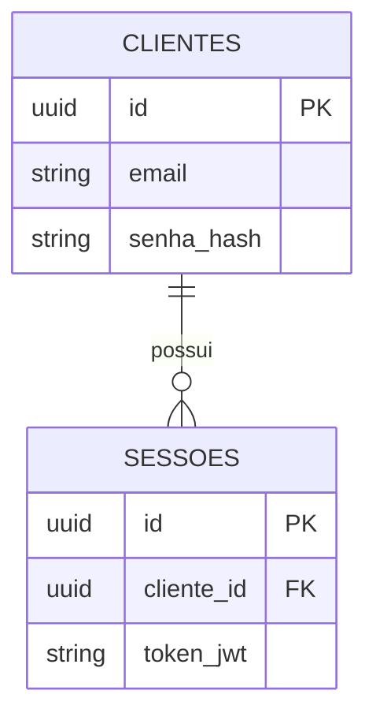

### ADR: Arquitetura de Gestão de Identidade e Acesso (IAM)

**Estilo Arquitetural:** Adotaremos uma arquitetura em camadas (Layered Architecture) para garantir o desacoplamento entre a interface, a lógica de negócio e a persistência de dados, facilitando a manutenção e a testabilidade do módulo de autenticação.

| Categoria | Padrão | Aplicação |
| :--- | :--- | :--- |
| **Criação** | Factory Method | Instanciação de objetos de usuário conforme o tipo de conta. |
| **Estrutural** | Proxy | Controle de acesso a métodos sensíveis (autenticação). |
| **Comportamental** | Strategy | Validação de senhas (ex: complexidade, hashing). |
| **GRASP** | Information Expert | Classe `Usuario` detém os dados e regras de validação do perfil. |
| **GRASP** | Repository | Abstração da persistência para isolar o acesso ao banco de dados. |

```sql
CREATE TABLE clientes (
    id UUID PRIMARY KEY,
    email VARCHAR(255) UNIQUE NOT NULL,
    senha_hash VARCHAR(255) NOT NULL,
    criado_em TIMESTAMP DEFAULT CURRENT_TIMESTAMP
);

CREATE TABLE sessoes (
    id UUID PRIMARY KEY,
    cliente_id UUID NOT NULL,
    token_jwt TEXT NOT NULL,
    expiracao TIMESTAMP NOT NULL,
    FOREIGN KEY (cliente_id) REFERENCES clientes(id)
);
```



**Trade-offs:**
* **Vantagens:** Alta coesão, facilidade de substituição de mecanismos de persistência e segurança centralizada.
* **Desvantagens:** Overhead inicial de implementação devido à separação de camadas e complexidade adicional para sistemas de escala mínima.